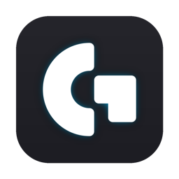
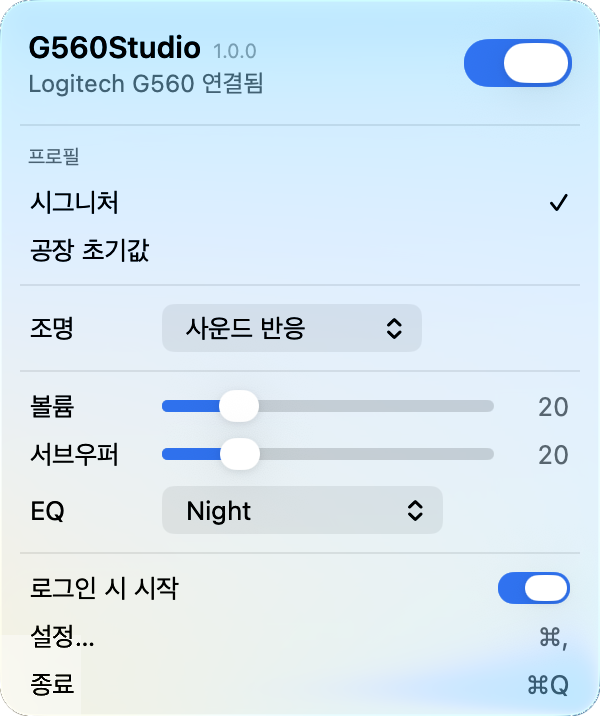
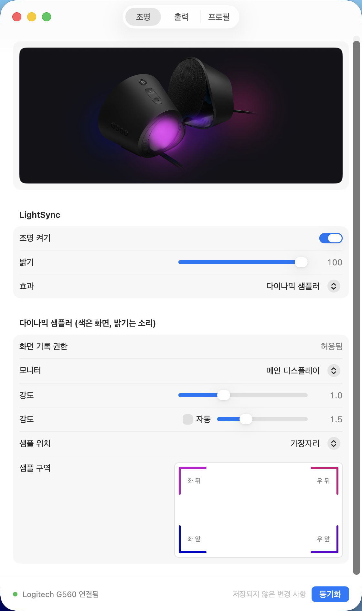
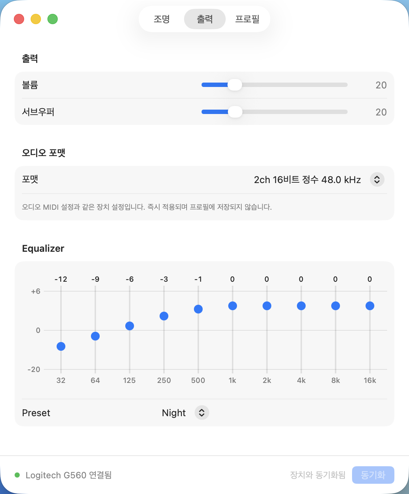
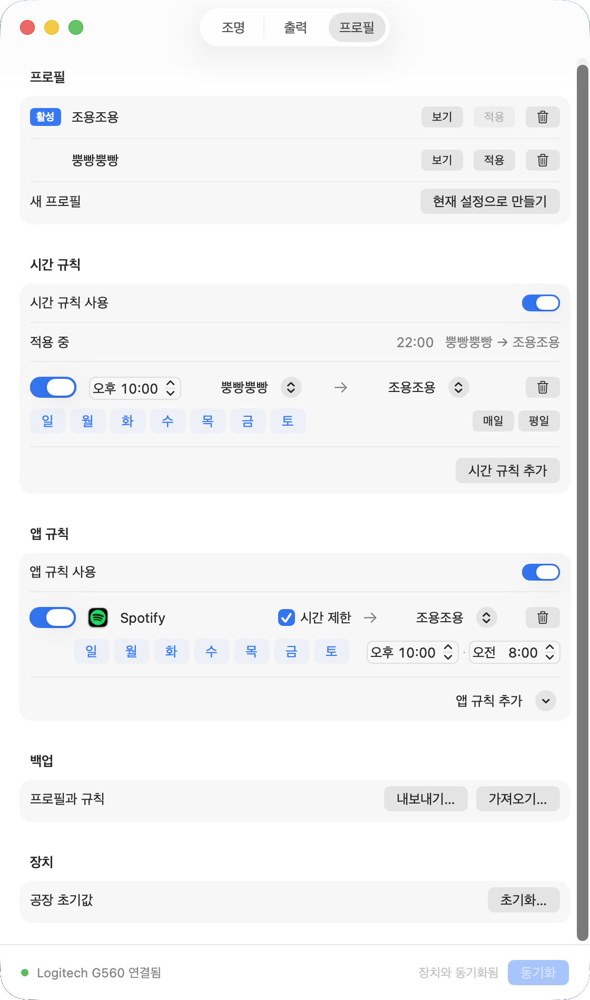
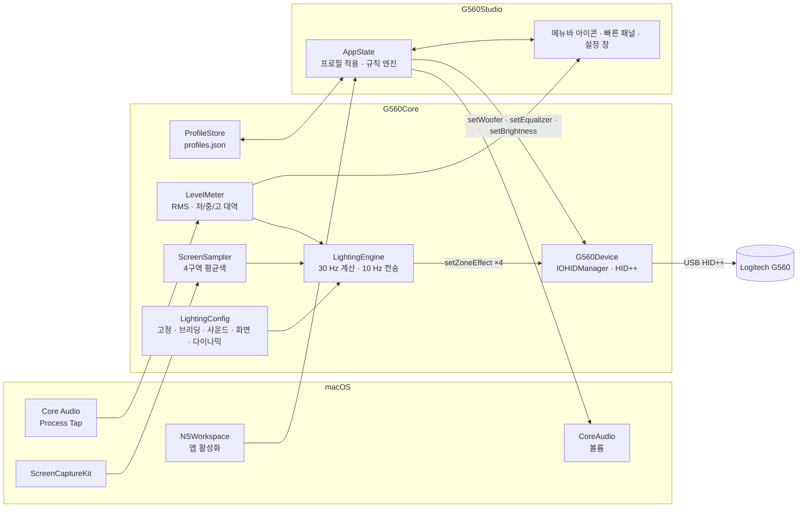
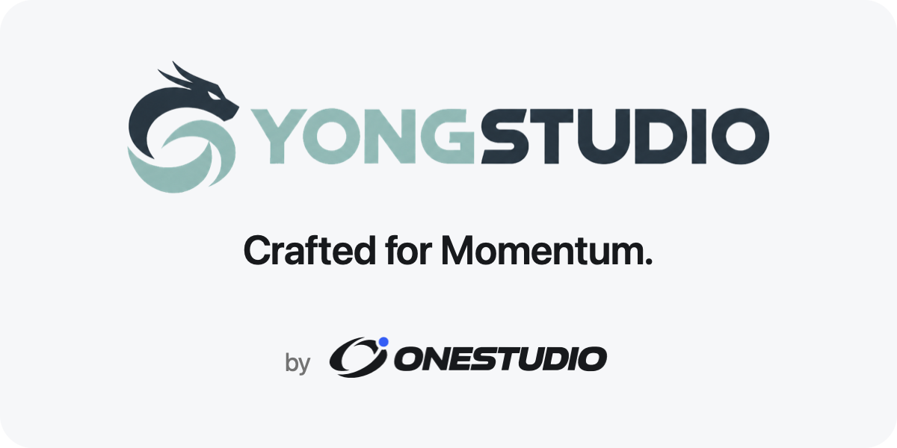

# G560Studio

<p align="center"></p>
<p align="center">Logitech G560을 G HUB 없이 macOS 메뉴바에서 제어하는 앱입니다.</p>

macOS용 G HUB에는 소리에 반응하는 LightSync가 없고, 서브우퍼를 줄이려면 G HUB가 있어야 합니다. 둘 다 되게 만들었습니다 — 그리고 G HUB에 없는 것들도: 화면 색을 따라가는 조명, 화면 색 + 소리 밝기를 합친 **다이나믹 샘플러**, 하드웨어 EQ 프리셋, 시간·앱 기준 자동 프로필 전환.

## 요구 사항 · 사양

| 항목 | 내용 |
|---|---|
| 운영체제 | macOS 14.2 (Sonoma) 이상 |
| 아키텍처 | Apple Silicon (arm64) |
| 하드웨어 | Logitech G560 (USB 연결) |
| 동시 실행 | **G HUB가 설치되어 있으면 안 됩니다** — 같은 장치를 잡아 충돌합니다 |
| 권한 | 시스템 오디오 녹음 (필수), 화면 기록 (화면·다이나믹 샘플러 사용 시) |
| 설치 용량 | 약 2.6 MB (다운로드 zip 약 1 MB) |
| 메모리 | 약 80 MB (화면 샘플러 사용 시 최대 ~110 MB) |
| CPU (M3 Pro, 모니터 3대 기준) | 사운드 반응 재생 중 약 13~18% · 설정 창을 열어 두면 +8~10% (미리보기 30 Hz) |
| 의존성 | 없음 (외부 라이브러리·런타임 미사용, 순수 Swift + 시스템 프레임워크) |
| 조명 갱신 | 화면 표시 30 Hz · 장치 전송 약 10 Hz, 변화가 있는 존만 전송 |
| 배포 | 자체 서명 (Developer ID 공증 없음) · 오픈소스 |

CPU·메모리는 M3 Pro 실측 기준이며 재생 콘텐츠와 디스플레이 수에 따라 달라집니다 (메뉴바 아이콘 갱신 비용은 모니터 수에 비례).

## 설치

1. [Releases](https://github.com/yong6330/G560Studio/releases)에서 `G560Studio-x.y.z.zip`을 받아 압축을 풀고 `G560Studio.app`을 `응용 프로그램` 폴더로 옮깁니다.
2. 자체 서명 앱이라 처음엔 Gatekeeper가 막습니다. **Finder에서 우클릭 → 열기 → 열기** 한 번이면 됩니다.
   (터미널: `xattr -dr com.apple.quarantine /Applications/G560Studio.app`)
3. 첫 실행 시 **시스템 오디오 녹음** 권한을 허용합니다. 소리 레벨 계산에만 쓰고 저장하지 않습니다.
4. 화면 샘플러를 쓰려면 **화면 기록** 권한도 허용한 뒤 앱을 재시작합니다.
5. 메뉴바 패널에서 **로그인 시 시작**을 켜두면 편합니다.

## 화면별 기능

### 메뉴바 아이콘 · 빠른 패널



메뉴바 아이콘은 재생 중인 소리의 파형을 **지금 스피커에 켜진 색**으로 그립니다. 뒤 레이어는 고음(뒤쪽 존 색), 앞 레이어는 저음(앞쪽 존 색).

패널에서 바로:
- 조명 켜기/끄기, 연결 상태
- 프로필 전환
- 조명 효과 전환 (색·파라미터는 유지)
- 볼륨 · 서브우퍼 슬라이더
- EQ 프리셋
- 로그인 시 시작, 설정 (⌘,), 종료 (⌘Q)

여기서 바꾼 값은 즉시 장치에 적용되고 활성 프로필에 저장됩니다.

<br clear="right">

### 조명 탭



상단의 스피커는 실제 4존 색을 실시간으로 보여줍니다.

- **밝기** — 0~100 (소프트웨어 스케일)
- **효과**
  - 고정 — 4존 각각 색 지정 또는 레인보우
  - 브리딩 — 주기 1~10초
  - 사운드 반응 — 감도(수동/자동), 저음·고음을 앞뒤 존으로 나눠 보내기
  - 화면 샘플러 — 화면 가장자리 색을 따라감. 모니터 선택, 강도, 샘플 위치(가장자리 ↔ 안쪽 40%)
  - 다이나믹 샘플러 — 색은 화면, 밝기는 소리
- **색상** — 레인보우(색 변화 속도 수동/자동) 또는 존별 지정 (색 이름 · hex 함께 표시)

감도·속도의 **자동**은 최근 몇 초의 피크를 기준으로 정규화해서 조용한 곡도 시끄러운 곡도 꽉 차게 반응합니다.

<br clear="right">

### 출력 탭



- **볼륨** — macOS 출력 볼륨 (CoreAudio). 스피커 보호를 위해 5% 아래와 음소거는 보내지 않고, 앱을 켤 때는 현재 볼륨을 그대로 둡니다 (프로필을 바꿀 때만 적용)
- **서브우퍼** — 0~100, 장치에 직접 씀 (아파트에서 제일 중요한 슬라이더)
- **Equalizer** — 10밴드 하드웨어 EQ (32 Hz ~ 16 kHz, −20 ~ +6 dB), Spotify 목록을 옮긴 프리셋 23종 + Custom. 장치 EEPROM에 저장되므로 슬라이더를 놓을 때만 씁니다.

<br clear="right">

### 프로필 탭



- **프로필** — 조명·밝기·볼륨·서브우퍼·EQ 한 묶음. 보기 / 적용 / 삭제, 이름은 바로 편집
- **시간 규칙** — `시각 · 요일 · 이전 프로필 → 다음 프로필`. 앱을 늦게 켜도 현재 시각에 맞는 프로필이 잡힙니다.
- **앱 규칙** — 이 앱이 앞에 오면 프로필 전환, 벗어나면 이전 프로필로 복귀. 요일·시간대 제한 가능 (예: 평일 22:00~08:00에만). 앱 규칙이 시간 규칙보다 우선합니다.
- **백업** — 프로필과 규칙을 JSON으로 내보내기/가져오기
- **장치** — 공장 초기값 프로필로 되돌리기

설정 창의 변경은 하단 **동기화**(⌘S)를 눌러야 장치에 적용·저장됩니다. 변경이 있는 채로 탭을 옮기면 물어봅니다.

<br clear="right">

## 아키텍처



- **G560Core** — UI를 모르는 순수 로직. 장치 통신, 조명 계산, 오디오/화면 샘플링, 프로필 저장. 단위 테스트 대상.
- **G560Studio** — SwiftUI 앱. `AppState`가 프로필 적용과 규칙(시간·앱) 판단을 맡고, 뷰는 그걸 그리기만 합니다.
- **g560ctl** — 개발·복구용 CLI (`status`, `led`, `woofer`, `eq`, `restore` …).
- **tools/** — 프로토콜을 알아낼 때 쓴 Python 스크립트와 공장 초기값 스냅샷.

조명 애니메이션은 전부 소프트웨어에서 계산하고 장치에는 "존 N을 이 색으로" 명령 하나만 10 Hz로 보냅니다. 장치에 쓰는 HID++ 명령은 재전송 검증된 4개(LED, 서브우퍼, EQ, 밝기)뿐이고, 펌웨어·리셋 계열은 호출하지 않습니다. 자세한 실측 내용은 [docs/protocol.md](docs/protocol.md).

## 문제 해결

**스피커가 USB로 붙었다 떨어지기를 반복하고, 알림음은 나는데 음악(USB·블루투스·헤드폰)이 전부 무음일 때** — 펌웨어가 "음소거 + 최저 볼륨" 상태로 잠긴 경우입니다 (펌웨어 122.3.23 변경 내역: "볼륨 0에서 헤드폰 분리 시 영구 음소거" 수정). Windows PC에 USB로 연결하고 스피커 전원을 껐다 켜서 인식된 순간 Logitech 공식 [G560Update_122.3.23.exe](https://download01.logi.com/web/ftp/pub/techsupport/gaming/G560Update_122.3.23.exe)로 펌웨어를 다시 설치한 뒤, Windows 사운드 설정에서 음소거를 풀고 볼륨을 올리면 복구됩니다. 이 앱은 그 상태를 피하려고 볼륨 0·음소거를 보내지 않습니다.

## 소스에서 빌드

Xcode 26 이상.

```bash
scripts/bundle.sh release && cp -R build/G560Studio.app /Applications/
```

macOS 권한(오디오·화면 기록)은 코드 서명에 묶이기 때문에 ad-hoc 서명이면 빌드할 때마다 권한이 초기화됩니다. `G560Studio Dev`라는 이름의 자체 서명 코드 서명 인증서를 키체인에 만들어 두면 `scripts/bundle.sh`가 자동으로 그걸로 서명합니다 (`CODESIGN_IDENTITY`로 변경 가능).

테스트:

```bash
export DEVELOPER_DIR=/Applications/Xcode.app/Contents/Developer
swift test
```

CLI / 복구:

```bash
swift run g560ctl status
swift run g560ctl restore                           # 서브우퍼 40, EQ Flat, 밝기 100
tools/.venv/bin/python tools/g560probe.py restore   # Python 쪽 복구 (factory-defaults.json 기준)
```

## 라이선스

이 오픈소스 ONESTUDIO의 G560Studio 프로젝트는 [MIT 라이선스](LICENSE)를 따릅니다.

`Assets/`의 로고와 제품 사진은 Logitech 소유이며, 비상업적 개인 활용 목적으로만 포함되어 있습니다. 이 프로젝트는 Logitech과 무관합니다.

## 개발자

- 기획 / 총괄 — 용석희
- 개발 — 클로드 코드

<p align="center"></p>
